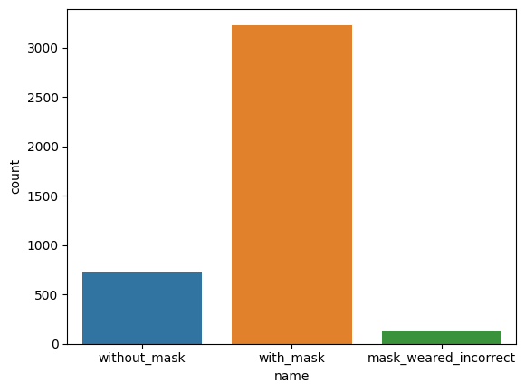

# Face Mask Detection with YOLOv8

A computer-vision project that detects whether people are wearing face masks, using a YOLOv8 model fine-tuned on a public face-mask dataset, and serves the model through a small Flask web application (image upload, video upload and live webcam).

> Original project description: *"Developed a computer vision system to detect mask compliance (nomask, incorrect mask, or correct mask) using YOLOv8, and deployed the trained model in a real-time application. Achieved 85% accuracy. Technologies: Python, Data pre-process, YOLOv8, Scikit-learn and Visualization."*

## Introduction

Mask compliance is an object-detection problem: find each face in an image and classify it as wearing a mask, not wearing one, or wearing one incorrectly. The notebook walks through the full workflow (annotation parsing, dataset preparation, training, evaluation), and the web application applies the trained model to new images, videos and a webcam stream.

## Objectives

- Detect faces and classify mask status into three classes: **No mask**, **Mask**, **Incorrect** (mask worn incorrectly).
- Train a YOLOv8 model on a custom dataset prepared from XML annotations.
- Provide a simple interface for image, video and real-time webcam inference.

## Main features

| Feature | Where |
|---|---|
| Image upload with annotated result page and mask / no-mask counts | `app.py`, `templates/index.html`, `templates/result.html` |
| Video upload (chunked upload) with a processed, streamed result and counts | `app.py`, `templates/upload_video.html`, `templates/video_result.html`, `static/js/video_upload.js` |
| Real-time webcam detection | `app.py`, `templates/webcam.html` |
| End-to-end training notebook: XML parsing, dataset split, YOLOv8 training, testing | `notebooks/face-mask-detection-with-yolov8.ipynb` |

## Technologies

| Area | Tools (from the code) |
|---|---|
| Model | YOLOv8 (`ultralytics`), YOLOv8n base, fine-tuned |
| Web app | Flask, Werkzeug, HTML, CSS, JavaScript |
| Image and video | OpenCV (`cv2`), Pillow |
| Data preparation and analysis | pandas, NumPy, scikit-learn, Matplotlib, Seaborn (notebook) |

## Dataset

The notebook states the data come from the Kaggle dataset [Face Mask Detection](https://www.kaggle.com/datasets/andrewmvd/face-mask-detection): images with one XML annotation file per image. The dataset's licence is not recorded in this repository; check the Kaggle page before reuse. The raw dataset is **not** included here.

The notebook notes a strong class imbalance: far more *with mask* examples than *without mask*, and very few *mask worn incorrectly*.



*Figure: number of annotated objects per class (from the notebook output).*

## Training configuration

From `reports/training/args.yaml` (the recorded Ultralytics run `yolov8n_custom7`):

| Setting | Value |
|---|---|
| Task | detect |
| Base model | `yolov8n.pt` (pretrained) |
| Epochs | 50 |
| Batch size | 8 |
| Image size | 640 |

## Existing results

The repository's description says "Achieved 85% accuracy"; the metric behind that figure is not documented here. What the training log (`reports/training/results.csv`, Ultralytics validation metrics per epoch) records:

| Metric | Final epoch (50) | Best epoch by mAP50-95 (38) |
|---|---|---|
| Precision | 0.7733 | 0.8867 |
| Recall | 0.7279 | 0.6782 |
| mAP50 | 0.7835 | 0.7849 |
| mAP50-95 | 0.5498 | 0.5724 |

These are the figures the repository can substantiate. Object detectors are normally reported with precision, recall and mAP rather than accuracy.

## Folder structure

```
Face-mask-detection/
├── app.py                      # Flask application (routes, inference, video/webcam streaming)
├── templates/                  # HTML pages rendered by Flask
├── static/
│   ├── css/styles.css
│   └── js/                     # script.js, video_upload.js
├── weights/best.pt             # trained YOLOv8 weights loaded by app.py
├── notebooks/                  # training and evaluation notebook
├── reports/training/           # args.yaml and results.csv from the training run
└── assets/images/              # figures used in this README
```

The files were originally uploaded to the repository root. They were moved (file locations only; no file contents changed) into the folder layout that `app.py` already expects: `render_template(...)` looks in `templates/`, `url_for('static', ...)` in `static/`, and the model is loaded from `./weights/best.pt`.

## Installation

No requirements file exists in the repository and the library versions used were not recorded. Based on the imports in `app.py`, the application needs:

```bash
pip install flask ultralytics opencv-python pillow
```

## Usage

```bash
python app.py
```

This starts the Flask development server (`debug=True`) on Flask's default address, `http://127.0.0.1:5000`. The `static/uploads/` folder is created automatically on first run.

## Limitations

- No `requirements.txt`; dependency versions are unknown.
- The notebook and `args.yaml` contain the original absolute local paths (`D:\...`) and the notebook outputs show photos from the public dataset, so the notebook cannot be re-run as-is on another machine.
- `app.py` expects `static/favicon.ico`, which is not in the repository.
- `static/js/script.js` contains a Jinja expression (`{{ url_for(...) }}`); Flask does not process templates inside static files.
- The "85% accuracy" figure in the original description is not reproduced by the logged detection metrics above.
- No tests. The application was not re-run when the files were reorganized; the new locations were checked against the paths used in the code.
- The *incorrect mask* class has very few training examples, so performance on it is expected to be weaker.

## References and acknowledgements

- Dataset: [Face Mask Detection](https://www.kaggle.com/datasets/andrewmvd/face-mask-detection) (Kaggle, by andrewmvd).
- Model: [Ultralytics YOLOv8](https://github.com/ultralytics/ultralytics).
